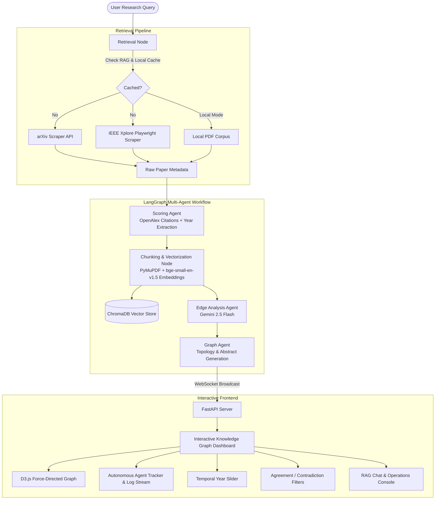

# 🌐 Agentic AI Research Paper Scraper & Knowledge Graph RAG

An autonomous, multi-agent literature research synthesis platform that retrieves academic papers from arXiv and IEEE Xplore, performs bibliometric scoring, embeds full-text documents into vector memory, extracts semantic relationships, and visualizes research topology in a dynamic, interactive D3.js Knowledge Graph.

---

## 🚀 Key Capabilities

- **Autonomous Paper Retrieval**: Queries arXiv API and IEEE Xplore using Playwright headless browser automation.
- **Bibliometric Scoring & Citation Ranking**: Validates papers against OpenAlex to fetch citation counts, publication years, and calculates logarithmic quality scores.
- **RAG & Vector Memory**: Parses PDFs with PyMuPDF, chunks text, and vectorizes embeddings locally using `BAAI/bge-small-en-v1.5` in ChromaDB.
- **Content-Aware Semantic Edge Analysis**: Compares pairwise papers using LLMs to detect **Agreement**, **Methodological Contradiction**, and **Weak Evidence Overlap**.
- **Interactive D3.js Knowledge Topology**:
  - D3 force-directed simulation with draggable nodes and relaxed physics spacing.
  - Autonomous agent visualizer dots patrolling the graph with color-coded live thought streams.
  - **Temporal Evolution Slider**: Dynamically adjusts to actual publication years extracted directly from papers.
  - **Relationship Filter Tabs**: Isolate Agreements (Emerald), Contradictions (Magenta), or Weak overlaps (Yellow) with glowing visual feedback.
  - **Clean Abstract Extraction**: Extracts genuine paper abstracts and core summaries directly from PDF text without publisher headers or metadata noise.
- **Real-Time 6-Step RAG Visualizer**: Live step-by-step telemetry tracker overlay with elapsed execution timers powered by WebSockets.
- **Interactive Research Sidebar Operations**:
  - 🧪 **Hypothesis Generator**: Formulates cross-paper hypotheses and novelty metrics.
  - ⚔️ **Contradiction Finder**: Uncovers conflicting findings and opposing methodologies.
  - 🌉 **Research Bridge Finder**: Identifies cross-domain synthesis opportunities.
  - 📈 **Trajectory Predictor**: Forecasts 3-year research directions.
  - 💬 **Full-Text RAG Chat**: Conversational querying directly grounded in indexed paper chunks.

---

## 🏛️ System Architecture



---

## 📂 Project Directory Structure

```plaintext
AgenticAI-ResearchScraper/
├── data/
│   ├── papers/
│   │   ├── arxiv/             # Downloaded arXiv PDF papers
│   │   └── ieee/              # Downloaded IEEE Xplore PDF papers
│   └── chroma_db/             # Local Chroma vector database storage
├── lib/                       # Third-party visualization and UI assets
├── src/
│   ├── agent/
│   │   ├── critic_agent.py        # Evaluates draft quality and validity
│   │   ├── drafting_agent.py      # Synthesizes literature review drafts
│   │   ├── edge_agent.py          # Pairwise semantic relationship analyzer
│   │   ├── hypothesis_agent.py    # Generates cross-paper hypotheses
│   │   ├── orchestrator.py        # LangChain agent workflow coordinator
│   │   ├── revision_agent.py      # Refines synthesized text
│   │   ├── scoring_agent.py       # Bibliometric citations & scoring
│   │   ├── sidebar_operations.py  # Deep analysis handlers & streaming chat
│   │   └── summary_agent.py       # Core paper summary generator
│   ├── graphs/
│   │   └── graph_builder.py       # Topology constructor & abstract extractor
│   ├── memory/
│   │   ├── cache_manager.py       # LLM query cache manager
│   │   └── state.py               # LangGraph ResearchState definitions
│   ├── processors/
│   │   └── pdf_parser.py          # PyMuPDF block parser & cleaner
│   ├── rag/
│   │   └── vector_store.py        # ChromaDB & HuggingFace embeddings
│   ├── scrapers/
│   │   ├── arxiv_scraper.py       # arXiv API client & citation validator
│   │   └── ieee_scraper.py        # Playwright scraper for IEEE Xplore
│   └── utils/
│       └── env_loader.py          # Environment configuration helper
├── cookie_manager.py          # Session cookie utility for scrapers
├── knowledge_graph.html       # D3.js interactive frontend dashboard
├── main.py                    # LangGraph workflow definition & pipeline entry
├── server.py                  # FastAPI WebSocket server & REST endpoints
├── requirements.txt           # Python dependencies
├── .env.example               # Template environment configuration
└── README.md                  # Project documentation
```

---

## 🛠️ Prerequisites & Installation

### 1. Clone the Repository
```bash
git clone https://github.com/SamXavii902/Agentic-Research-Paper-Scraper-RAG.git
cd Agentic-Research-Paper-Scraper-RAG
```

### 2. Set Up Virtual Environment
```bash
python -m venv venv

# On Windows:
venv\Scripts\activate

# On macOS/Linux:
source venv/bin/activate
```

### 3. Install Dependencies
```bash
pip install -r requirements.txt
playwright install
```

### 4. Configure Environment Variables
Copy `.env.example` to `.env`:
```bash
cp .env.example .env
```
Fill in your API keys in `.env`:
```env
# Google Gemini API Key (Recommended for agent operations & edge synthesis)
GEMINI_API_KEY=your_gemini_api_key_here

# Optional alternatives:
OPENAI_API_KEY=your_openai_api_key_here
GROQ_API_KEY=your_groq_api_key_here
```

---

## ⚡ Running the Application

### Launch the Full Web Dashboard
Start the FastAPI server:
```bash
python server.py
```
Open your browser and navigate to:
```
http://localhost:8000
```

### Two Search Modes:
1. **Run Local**:
   - Uses the pre-downloaded papers in `data/papers/`.
   - Bypasses external web scrapers for rapid, local execution in seconds.
   - Extracts publication years and abstracts directly from local documents.
2. **Search (Live Scraping)**:
   - Queries arXiv and IEEE in real-time.
   - Downloads PDF publications, fetches live citation counts via OpenAlex, and indexes fresh vectors into ChromaDB.

---

## 🧩 UI Controls & Features

| Control | Description |
|---|---|
| **Timeline Slider** | Filters graph nodes by publication year. Automatically bounds `min` and `max` years based on the retrieved papers. |
| **Edge Type Tabs** | Toggles visible edges between **All**, **Agr** (Agreement), **Con** (Contradiction), and **Wk** (Weak Evidence). Hovering over empty spaces will never reveal filtered edges. |
| **Node Expansion** | Click any paper node to view citation metrics, quality score, confidence level, and clean abstract extraction. |
| **Draggable Physics** | Drag and reposition nodes across the canvas; simulation dynamically relaxes spacing to avoid overlap. |
| **Sidebar Toolkit** | Trigger on-demand deep-dives: *Semantic Search*, *Find Contradictions*, *Synthesize Review*, *Predict Trajectories*, and *Find Bridges*. |
| **RAG Interactive Chat** | Conversational assistant streaming answers directly citing the active paper collection. |

---

## 📄 License

Distributed under the MIT License. See `LICENSE` for details.
